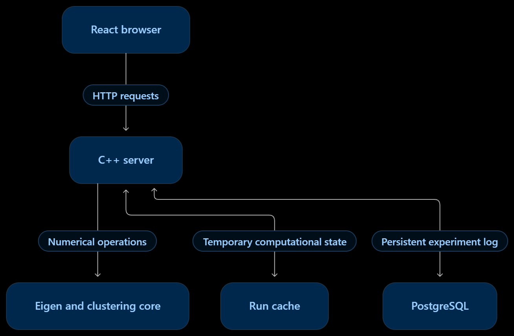

# Image Spectral Segmentation

https://github.com/user-attachments/assets/7283db14-2c76-44a8-b695-2ca3e6e86826

The user is prompted to upload an image locally. After clicking the "Run Segmentation" button, the numerical engine splits the uploaded image into regions using <b><i>spectral clustering</i></b> technique. Internally, each pixel becomes a node in a sparse
similarity graph. The pipeline solves for $k$ leading eigenvectors of the normalized affinity
matrix via Shi & Malik's normalized cuts and the Ng–Jordan–Weiss formulation, where pixels are then grouped using $k$-means++ clustering method on the spectral embedding.

The core is written in C++17 with Eigen. A C++ HTTP server exposes it to a ReactJS frontend, and
PostgreSQL keeps a log of the experiments for each run. Everything runs under Docker Compose.

## How to run

Run `docker compose up --build` in terminal and then go to http://localhost:8080 on web browser.

## Key features

- **Sparse numerical computation:** construct a local pixel-similarity graph, compute a spectral embedding, and cluster pixels using k-means++ initialization and Lloyd iterations.
- **Reuse expensive intermediates:** cache the normalized graph and eigenvectors so changing the number of segments can reuse previous computation.
- **Persistent experiment logging:** store run metadata and selected measurements in PostgreSQL
- **Concurrency control:** protect shared cache entries and database access with mutexes; use result identifiers to prevent saving a superseded request

## Project Structure

 

| File | Purpose |
| --- | --- |
| `src/image_io.*`, `src/preprocess.*` | Load image, downsample, and apply Gaussian blur |
| `src/graph.*` | Construct affinity matrix $W$ and normalized Laplacian matrix $L_{\text{sym}}$ |
| `src/eigensolver.*` | Run Rayleigh Quotient Iteration (RQI) with warm-up steps and eigenvector deflation |
| `src/clustering.*` | Run $k$-means++ clustering using Lloyd iteration method |
| `src/main.cpp` | Run the segmentation pipeline |
| `src/rqi_experiments.cpp` | Test how eigensolver performs on contrived images |
| `src/server/` | Connects ReactJS interface to the numerical engine and database |
| `db/schema.sql` | Create DB tables for segmentation run and their experiments |
| `web/` | Setup ReactJS frontend and build using Vite |

## REST API endpoints

| Endpoint | Purpose |
| --- | --- |
| `POST /api/runs` | `{filename, width, height, pixels, k, thumbnail, blur_sigma}`: new run + first segmentation |
| `POST /api/runs/:id/segmentations` | `{k}`: segmentation from the cache (`410` if evicted) |
| `POST /api/runs/:id/experiments` | `{result_id}`: save the latest result to the log (`409` if replaced) |
| `DELETE /api/experiments/:id` | delete one log entry |
| `DELETE /api/runs/:id/experiments` | clear a run's log |
| `GET /api/runs?limit=20` | history of recent runs |
| `GET /api/runs/:id` | one run with its experiment log |
| `GET /api/health` | liveness check |

## Remarks

- **The browser does the image processing.** It decodes the upload, resizes it to at most 160 px
  on a `<canvas>`, and sends raw RGB bytes. It also paints the returned labels, either with
  palette colours or with each segment's mean colour.
- **Slider changes reuse cached eigenvectors.** The server keeps each run's matrix M and its
  eigenpairs in an in-memory LRU map keyed by `run_id`, holding 20 runs (`CACHE_CAPACITY`). A
  smaller k only reruns k-means, typically in 20–200 ms. A larger k computes just the missing
  eigenpairs, since RQI with deflation finds them one at a time. After a restart or an
  eviction, the API returns `410 Gone` and the page asks for a new upload.
- **PostgreSQL stores the log, not the results.** The `runs` table has one row per upload. The
  `experiments` table only gets a row when the user presses **Save to log**. Each row holds k,
  runtime, eigensolver and k-means time and iterations, memory usage and eigenvalues. Recent
  Jobs lists only runs with saved results. Each log row has a delete button, **Clear log**
  empties a run's log, and **Download CSV** exports it. **Reset** clears the page and restores
  the default settings without touching saved logs.
- **What triggers a recompute.** Changing k only reruns the clustering, plus any missing
  eigenpairs. Changing the Gaussian sigma changes the graph, so pressing Run builds a new run,
  with a new graph and new eigenvectors.
- **Memory usage** is the run's peak working set: M, the stored eigenvectors, and the largest
  sparse LU factorization.

